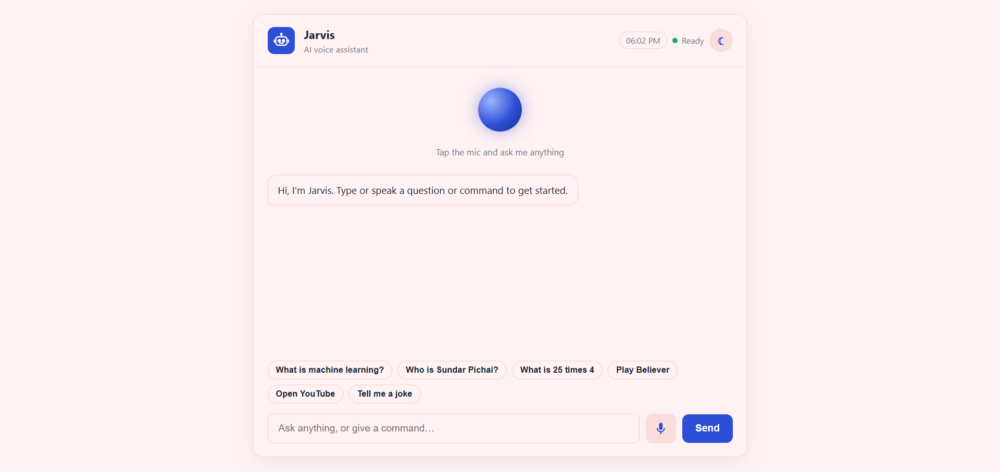
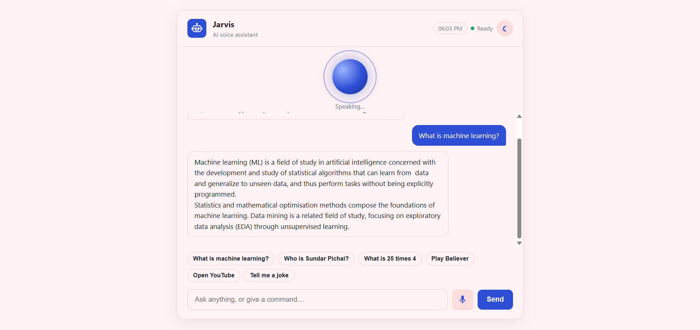
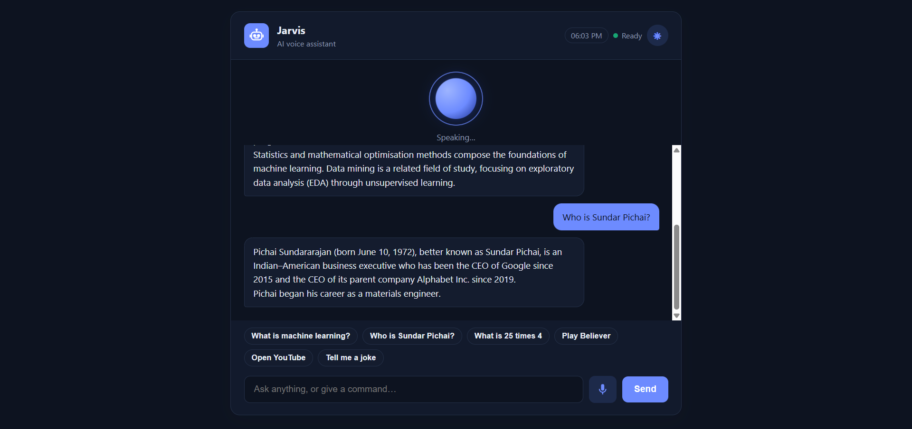

# jarvis-web-assistant
Voice-activated AI assistant built with JavaScript, using the Web Speech API and Wikipedia API.
# Jarvis Web – Voice Assistant

A voice-activated assistant that runs entirely in the browser. Speak or type a question or command, and Jarvis answers aloud, opens websites, plays songs, searches the web and does basic maths.

**Live demo:** [https://YOUR-VERCEL-LINK.vercel.app](https://YOUR-VERCEL-LINK.vercel.app)



## Features

- **Voice and text input:** press the mic and speak, or type in the box.
- **Question answering:** factual questions such as "What is machine learning?" are answered using the Wikipedia API.
- **Voice replies:** answers are read aloud using browser text-to-speech.
- **Commands:** open websites, search Google, play songs on YouTube, open news and weather.
- **Basic maths:** "What is 25 times 4" returns 100.
- **Animated voice orb:** changes colour and animation when Jarvis is listening or speaking.
- **Dark and light themes:** the choice is saved in your browser.
- **Typing effect:** replies appear letter by letter.
- **No API key and no backend:** a single `index.html` file.

## Screenshots

| Light theme | Listening | Dark theme |
|---|---|---|
|  |  |

## Example commands

| Say or type | What happens |
|---|---|
| What is machine learning? | Answers from Wikipedia |
| Who is Sundar Pichai? | Answers from Wikipedia |
| What is 25 times 4 | Calculates the result |
| Play Believer | Opens the song search on YouTube |
| Search for python tutorials | Opens a Google search |
| Open YouTube | Opens the site |
| Weather in Hyderabad | Opens the weather search |
| Tell me a joke | Tells a joke |

You can start any command with "Jarvis," if you like.

## Tech stack

- HTML5
- CSS3 (CSS variables for theming, animations)
- JavaScript (ES6, async/await, `fetch`)
- Web Speech API (`SpeechRecognition` and `SpeechSynthesis`)
- Wikipedia API
- Git and GitHub
- Vercel (deployment)

## How it works

1. `SpeechRecognition` converts your voice to text, or you type the text.
2. The command handler checks for built-in commands such as time, jokes, maths, play, search and open.
3. If nothing matches, the question is sent to the Wikipedia API with `fetch`, and the first few sentences of the best result are shown and spoken.
4. If Wikipedia has no answer, Jarvis opens a Google search instead.

## Run it locally

```bash
git clone https://github.com/RafikShaik07/jarvis-web-assistant.git
cd jarvis-web-assistant
```

Open `index.html` in Chrome or Edge. No installation or build step is needed.

## Browser support and microphone

- Voice input works best in **Google Chrome** and **Microsoft Edge**. Firefox does not support speech recognition, but typing still works.
- Click **Allow** when the browser asks for microphone access.
- If you see a "not-allowed" error, click the lock icon next to the address bar, set Microphone to Allow and reload.
- Voice input needs `https://` or `localhost`. The live demo link already uses https.

## Deploy your own

1. Fork this repository.
2. Go to [vercel.com](https://vercel.com), choose **Add New Project** and import your fork.
3. Click **Deploy**. No settings need to be changed.

## Future improvements

- Add more commands, such as reminders and notes.
- Add support for more languages.
- Connect an AI model through a serverless function for richer answers.

## Author

**Shaik Rafik**
